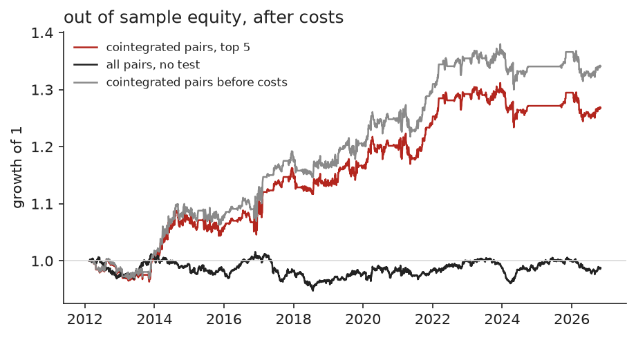
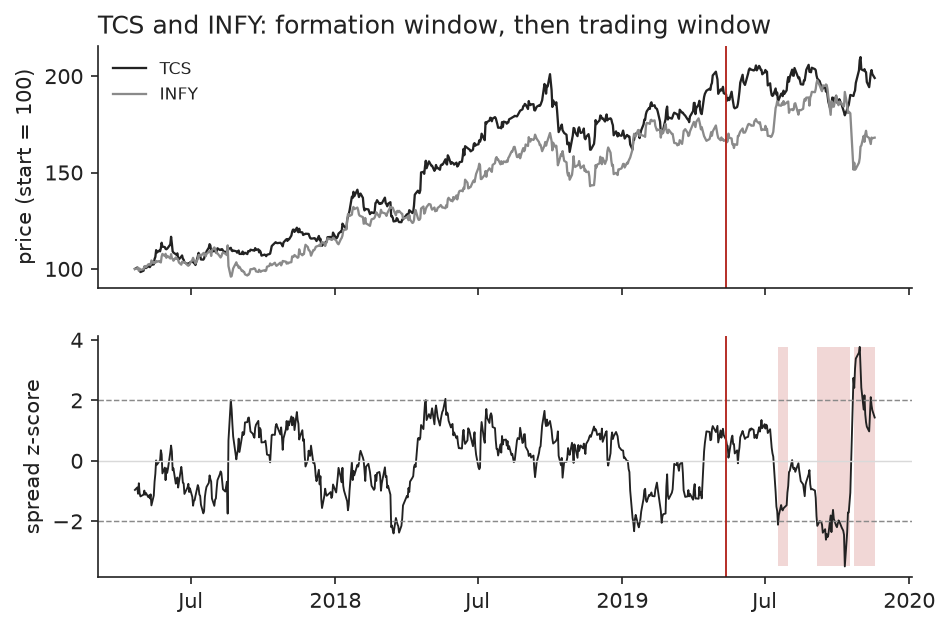
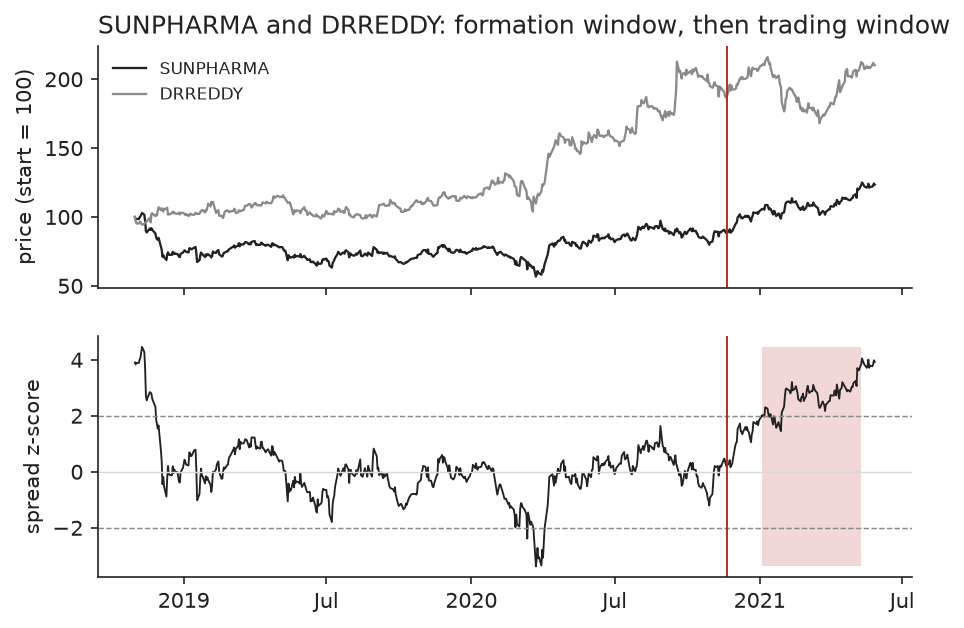

# pairs-trading

Statistical arbitrage on pairs of similar NSE stocks. Two stocks in the same sector are
tested for cointegration; when their spread drifts away from its usual level the strategy
buys the cheap one and shorts the expensive one, and closes when the spread comes back.

Everything is walk forward. Pairs are chosen on two years of data and traded on the
following six months, which the selection never saw. 25 stocks in 5 sectors (banks, IT,
auto, pharma, FMCG), 50 same-sector pairs, 29 trading windows from 2012-02-16 to
2026-10-30. Full output in [results/report.md](results/report.md).

## Result

Out of sample, after 10 basis points per leg per trade, on gross capital (long plus short):

| | return / yr | vol / yr | Sharpe | Sharpe 95% interval | max drawdown | beta to Nifty |
|---|---|---|---|---|---|---|
| cointegrated pairs, top 5 | 1.7% | 4.0% | 0.44 | 0.03 to 0.84 | 5.9% | +0.01 |
| same, before costs | 2.1% | 4.0% | 0.54 | 0.12 to 0.94 | 5.8% | +0.01 |
| all 50 pairs, no test | -0.1% | 2.2% | -0.03 | -0.53 to 0.45 | 6.7% | -0.01 |



The strategy is market neutral as intended (beta 0.01) and makes a small positive return.
It is a weak result, and these are the reasons to be careful with it:

- The profit is concentrated. TCS / Infosys accounts for 40% of the summed window returns.
  With that one pair removed from the universe the Sharpe ratio falls from 0.44 to 0.25
  and the return from 1.7% to 0.9% a year. Its best window (+17.5%) includes 2019-10-22,
  when Infosys fell 16.2% in a day while the strategy happened to be short it.
- It has faded. Sharpe 0.54 over 2012 to 2021, 0.14 over 2022 to 2026.
- Cointegration found in the formation window mostly does not last. 11.9% of pair-windows
  pass the 5% test in formation, where 5% would pass by chance alone. Of the 123 selected
  pair-windows only 6.5% still pass in the window they were traded in. The trading window
  is a quarter of the length, so the test has less power there, but the selected pairs do
  no better than unselected ones (10.3%).
- Selection still helps. Trading all 50 pairs without a test earns nothing, and none of
  20 runs that pick 5 same-sector pairs at random reaches the selected portfolio's Sharpe
  (their range is -0.34 to 0.25).
- Losses come from broken relationships. In 35 of 110 traded pair-windows the spread ran
  to 4 standard deviations and the position was stopped out, with a mean return of -4.62%.
  The other 75 made +3.75% on average and 81% were profitable.
- Removing the stop raises the Sharpe ratio to 0.75 in this sample. I kept the stop,
  because choosing settings after seeing the result is how backtests get inflated. The
  sensitivity table in the report shows the other settings (Sharpe 0.22 to 0.75).





## Method

1. Formation (504 days): for each same-sector pair regress log price of A on log price of
   B to get the hedge ratio, and run the Engle-Granger test on the residual spread.
2. Keep pairs with p below 0.05, a positive hedge ratio and a spread half-life between 2
   and 60 days. Take the 5 with the lowest p-value. Empty slots stay in cash.
3. Trading (next 126 days): the spread is measured in formation-window standard
   deviations, with the hedge ratio, mean and deviation frozen. Open when it passes 2,
   close when it returns inside 0.5, stop for the rest of the window when it passes 4,
   and close everything at the end of the window.
4. A position decided at one close earns from the next day. Costs are charged on both
   legs at every trade.

## Run it

```
uv venv && uv pip install -e ".[dev]"
.venv/bin/python -m pairs config.toml     # writes results/, about 30 seconds
.venv/bin/python -m pytest
```

`config.toml` holds the universe, window lengths, thresholds and costs.
`results/selected_pairs.csv` lists every selected pair-window with its hedge ratio,
p-values, half-life, number of entries and return.

## Tests

8 tests on synthetic data. They check that the hedge ratio and half-life recover known
values, that the cointegration test separates true pairs from independent random walks,
the position rule and the return arithmetic against hand-worked cases, and that changing
prices after a date leaves all earlier returns unchanged.

## Limits

- The universe is 25 large companies that exist today, so there is survivorship bias.
- Shorting Indian stocks overnight means using stock futures. Futures margin, roll costs
  and the basis are not modelled; returns are on gross notional.
- Daily closes only. Entry and exit at the close after the signal, no intraday fills.
- Engle-Granger depends on which stock is the dependent variable. Only one order is tested.
- Yahoo Finance prices are adjusted for splits and dividends but are not audited. The
  sample starts in February 2010 because Nestle India's first days of January 2010 are
  wrong in the source; the loader rejects any daily move above 40%.

## References

- Engle and Granger (1987), Co-integration and error correction.
- Gatev, Goetzmann and Rouwenhorst (2006), Pairs trading: performance of a relative-value arbitrage rule.
- Do and Faff (2010), Does simple pairs trading still work?
