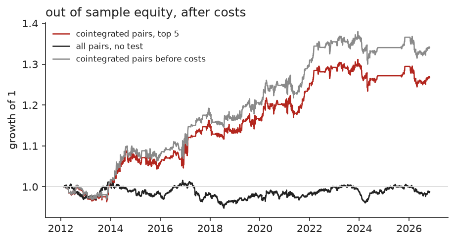
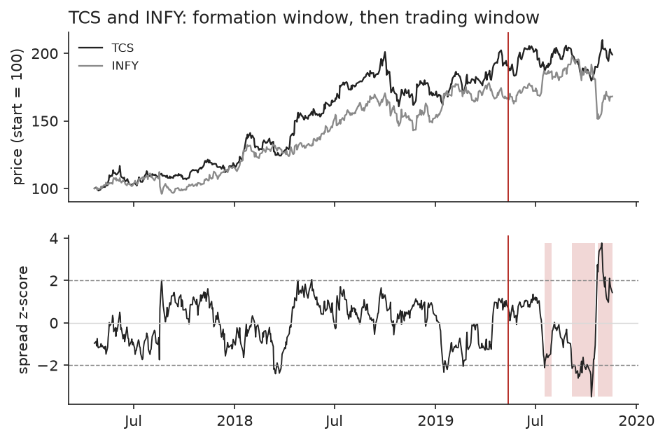
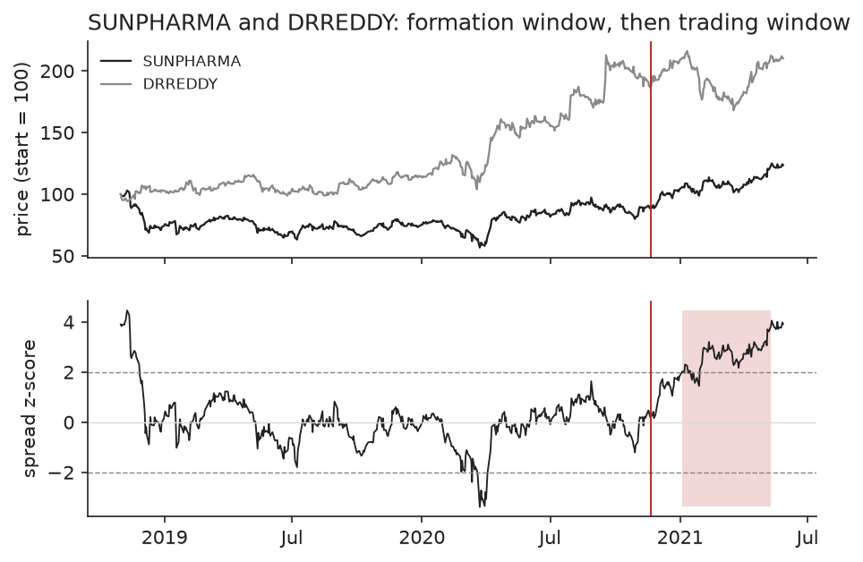

# Pairs trading on NSE stocks

25 stocks in 5 sectors, 50 same-sector pairs. Every 126 trading days the pairs are tested for cointegration on the previous 504 days, the best 5 are traded for the next 126 days, then the process repeats. 29 trading windows, 2012-02-16 to 2026-10-30. Enter at 2.0 standard deviations, exit at 0.5, stop at 4.0. 10 basis points per leg per trade. Returns are on gross capital (long plus short), with capital split evenly over 5 slots.

## Out of sample result

|  | return / yr | vol / yr | Sharpe | Sharpe 95% interval | max drawdown | beta to Nifty |
|---|---|---|---|---|---|---|
| cointegrated pairs, top 5 | 1.7% | 4.0% | 0.44 | 0.03 to 0.84 | 5.9% | +0.01 |
| same, before costs | 2.1% | 4.0% | 0.54 | 0.12 to 0.94 | 5.8% | +0.01 |
| all pairs, no test | -0.1% | 2.2% | -0.03 | -0.53 to 0.45 | 6.7% | -0.01 |

Control: 20 runs that pick 5 same-sector pairs at random each window have Sharpe ratios from -0.34 to 0.25, mean -0.01. 0 of 20 match or beat the cointegration selection.

## Does cointegration last?

Across all windows 11.9% of candidate pairs test as cointegrated at the 5% level in the formation window. Of the 123 pair-windows selected, 6.5% still test as cointegrated in the window they were traded in. For pairs picked without any test the figure is 10.3%.

| selected pair-windows | with at least one trade | profitable | hit the stop | mean return when traded | median half-life (days) |
|---|---|---|---|---|---|
| 123 | 110 | 64 (58%) | 35 (28%) | 1.09% | 13 |

Split by whether the stop was hit:

|  | pair-windows | mean return | share profitable |
|---|---|---|---|
| stop not hit | 75 | 3.75% | 81% |
| stop hit | 35 | -4.62% | 9% |

## By year

| year | pairs strategy | Nifty 50 |
|---|---|---|
| 2012 | -1.9% | 6.7% |
| 2013 | 3.1% | 6.8% |
| 2014 | 6.1% | 31.4% |
| 2015 | -1.2% | -4.1% |
| 2016 | 3.5% | 3.0% |
| 2017 | 4.4% | 28.6% |
| 2018 | -0.4% | 3.2% |
| 2019 | 1.8% | 12.0% |
| 2020 | 3.1% | 14.9% |
| 2021 | 4.0% | 24.1% |
| 2022 | 3.7% | 4.3% |
| 2023 | 0.3% | 20.0% |
| 2024 | -1.9% | 8.8% |
| 2025 | 1.8% | 10.5% |
| 2026 | -2.1% | -11.8% |

## Pairs selected most often

| pair | windows selected | sum of window returns |
|---|---|---|
| SUNPHARMA / LUPIN | 11 | -7.0% |
| TCS / INFY | 8 | 47.6% |
| NESTLEIND / DABUR | 7 | 10.3% |
| TCS / HCLTECH | 7 | 11.5% |
| HDFCBANK / AXISBANK | 7 | 9.2% |
| HINDUNILVR / NESTLEIND | 6 | 27.7% |
| HDFCBANK / KOTAKBANK | 5 | 10.7% |
| TCS / TECHM | 5 | 4.3% |
| DRREDDY / LUPIN | 5 | 10.3% |
| HEROMOTOCO / EICHERMOT | 4 | 3.7% |

## Best and worst pair-window

Best: TCS / INFY from 2019-05-13, 17.5%. Worst: SUNPHARMA / DRREDDY from 2020-11-20, -13.5%. The red line marks the end of the formation window; shading marks days with a position.

## Sensitivity

| setting | return / yr | Sharpe | max drawdown |
|---|---|---|---|
| base case | 1.7% | 0.44 | 5.9% |
| entry 1.5 | 1.9% | 0.44 | 7.6% |
| entry 2.5 | 1.5% | 0.44 | 5.1% |
| no stop | 3.6% | 0.75 | 5.9% |
| top 3 | 2.8% | 0.61 | 6.1% |
| top 10 | 1.0% | 0.42 | 5.1% |
| formation 252 days | 0.7% | 0.22 | 9.6% |
| trading 63 days | 1.6% | 0.43 | 8.1% |
| cost 20 bp | 1.3% | 0.34 | 6.1% |

